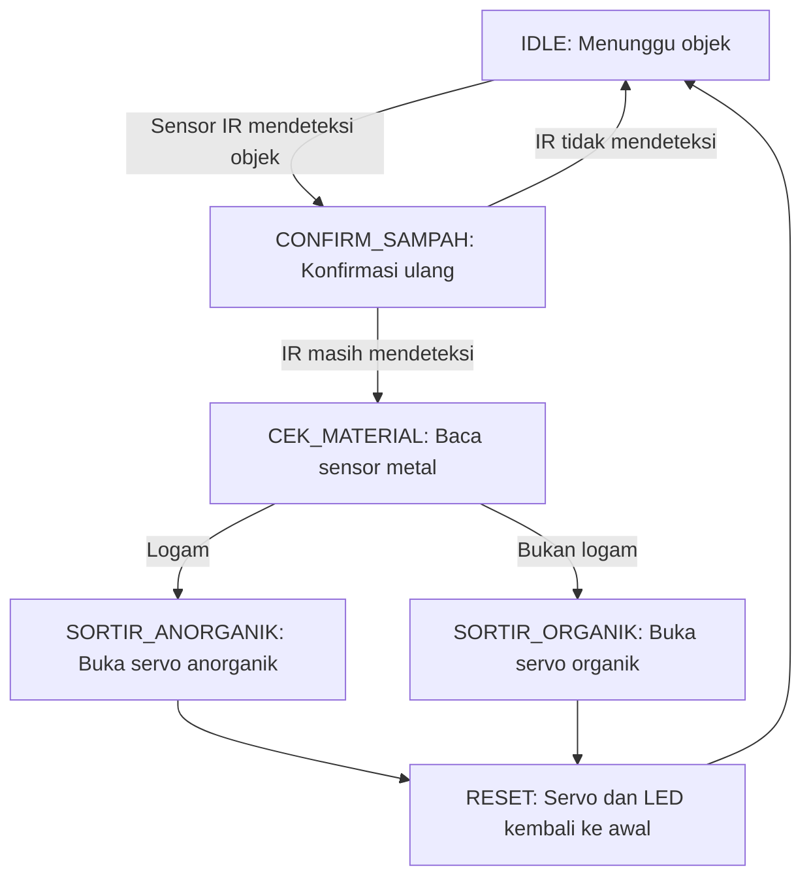

# 🗑️ Sistem Pemilah Sampah Otomatis (FSM)

Tempat sampah pintar yang memilah sampah secara otomatis menjadi **organik** dan **anorganik** menggunakan sensor IR, sensor metal, dan dua motor servo. Logika kendali disusun dengan arsitektur **Finite State Machine (FSM)** non-blocking berbasis `millis()`, tanpa `delay()`.

## 🧠 System Architecture & Features

- **Deteksi Objek**: Sensor IR mendeteksi sampah yang masuk, lalu dikonfirmasi ulang sebelum diproses agar tidak salah baca.
- **Klasifikasi Material**: Sensor metal menentukan jenis sampah. Terdeteksi logam diklasifikasikan sebagai **anorganik**, selain itu sebagai **organik**.
- **Sortir dengan Servo**: Dua servo terpisah (organik dan anorganik) membuka jalur sesuai jenis sampah.
- **Indikator LED**: Tiga LED menunjukkan status sistem (sedang memproses, anorganik, organik).
- **Debounce Sensor**: Pembacaan sensor IR dan metal memakai debounce 20 ms untuk menyaring noise.
- **Non-Blocking FSM**: Seluruh siklus berjalan berbasis `millis()`.

## 📌 Pin Mapping & Hardware Configuration

| Komponen | Pin | Keterangan |
|---|---|---|
| Sensor IR | 8 | Aktif LOW (objek terdeteksi) |
| Sensor Metal | 7 | Aktif LOW (logam terdeteksi) |
| Servo Organik | 6 | 0° (tutup), 90° (buka) |
| Servo Anorganik | 5 | 0° (tutup), 90° (buka) |
| LED M | 12 | Indikator objek terdeteksi / sedang diproses |
| LED K | 11 | Indikator sampah anorganik |
| LED H | 10 | Indikator sampah organik |

## ⚙️ Finite State Machine (FSM) Flow

### Penjelasan State

| State | Fungsi |
|---|---|
| `IDLE` | Menunggu sensor IR mendeteksi objek. LED M menyala saat objek terdeteksi. |
| `CONFIRM_SAMPAH` | Memastikan objek masih terdeteksi setelah jeda konfirmasi. Jika tidak, kembali ke `IDLE`. |
| `CEK_MATERIAL` | Membaca sensor metal untuk menentukan jenis sampah. |
| `SORTIR_ANORGANIK` | Setelah jeda, servo anorganik bergerak ke 90°. LED K menyala. |
| `SORTIR_ORGANIK` | Setelah jeda, servo organik bergerak ke 90°. LED H menyala. |
| `RESET` | Servo kembali ke 0°, semua LED mati, sistem kembali ke `IDLE`. |

## 🔧 Parameter Waktu

| Konstanta | Nilai | Fungsi |
|---|---|---|
| `confirmTime` | 400 ms | Jeda konfirmasi objek |
| `sensorTime` | 1500 ms | Interval pemanggilan FSM |
| `sortirTime` | 1500 ms | Jeda sebelum servo bergerak |
| `resetTime` | 1000 ms | Jeda sebelum sistem kembali ke awal |

## 💻 Software Stack

- **Framework:** Arduino
- **Library:** `Servo.h` (bawaan Arduino IDE)
- **IDE:** Arduino IDE / PlatformIO

## 🚀 Getting Started

1. Rangkai komponen sesuai tabel pin mapping di atas.
2. Buka file `.ino` di Arduino IDE.
3. Pilih board dan port yang sesuai, lalu unggah (*upload*) program.
4. Letakkan sampah di depan sensor IR. Sistem akan mengklasifikasikan dan memilahnya otomatis.